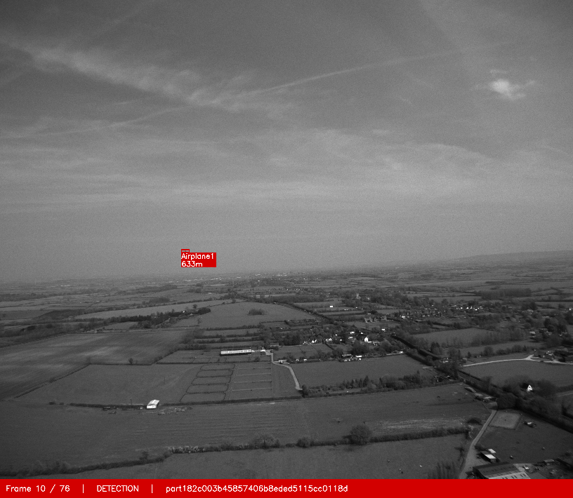
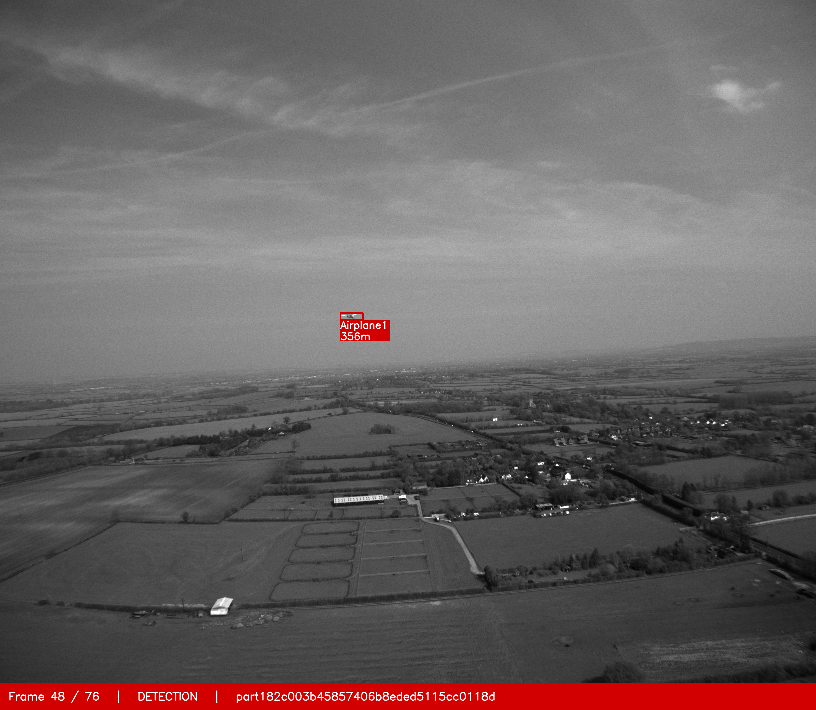
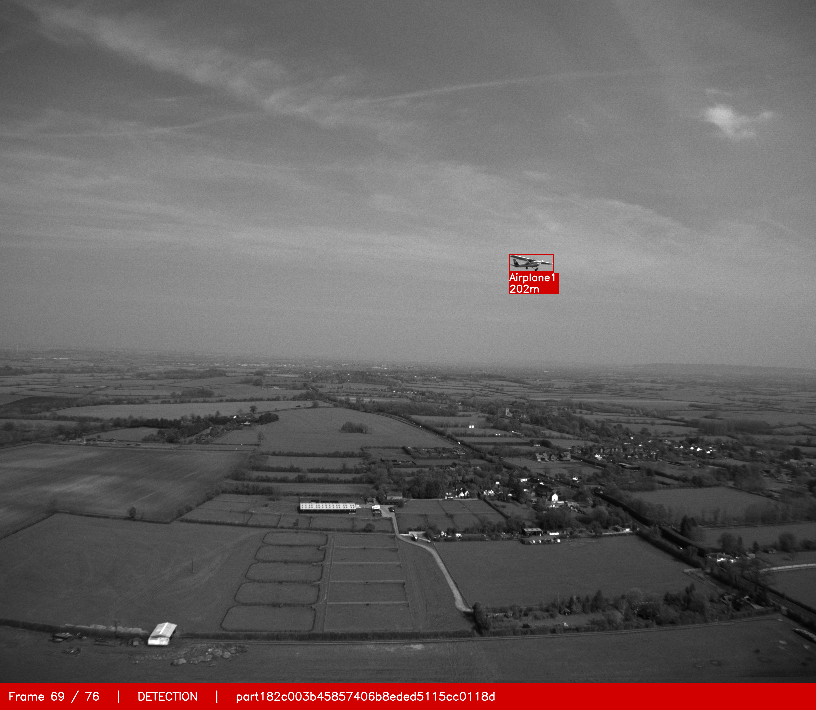

# Vision-Based Sense and Avoid: Monocular Airborne Object Tracking for Safe Drone Flight

## 📑 Contents

- [🛸 Overview](#-overview)  
- [📋 Project Details](#-project-details)  
- [🗂️ Project Structure](#️-project-structure)  
- [⚙️ Requirements](#️-requirements)  
- [🛠️ Setup](#️-setup)  
- [🗃️ Dataset](#️-dataset)  
  - [Data Tools](#data-tools)  
  - [Visualisation](#visualisation)  
- [📊 Baseline](#-baseline)  
  - [Winning Solution](#winning-solution)  
  - [Competition Results (Full AOT Dataset)](#competition-results-full-aot-dataset)  
  - [Hard Dataset Results](#hard-dataset-results)

---

## 🛸 Overview

This project tackles the challenge of detecting and tracking tiny airborne objects using only a
single monocular camera onboard a drone. Working with the Airborne Object Tracking (AOT) dataset,
a real-world collection of 5.9M+ images across diverse flight conditions, the goal is to develop
novel deep learning and multi-object tracking algorithms that achieve early detection with an
extremely low false alarm rate, enabling safe collision avoidance without unnecessary manoeuvres.

Objects in this dataset can appear as just a few pixels per frame, making this one of the most
challenging small-object detection problems in computer vision, and one of the most critical for
future autonomous flight systems.

For background on the dataset and benchmarks, see the
[Airborne Object Tracking Challenge on AIcrowd](https://www.aicrowd.com/challenges/airborne-object-tracking-challenge).

---

## 📋 Project Details

| Field            | Details                                                                                                |
|------------------|--------------------------------------------------------------------------------------------------------|
| **Sponsor**      | Lockheed Martin Australia – Advanced Systems & Technology Group                                        |
| **Supervisor**   | Dr Feras Dayoub ([feras.dayoub@adelaide.edu.au](mailto:feras.dayoub@adelaide.edu.au))                  |
| **Co-Supervisor**| Ms Kendall Louise Jenner ([kendall.l.jenner@global.lmco.com](mailto:kendall.l.jenner@global.lmco.com)) |
| **Second Marker**| Dr Lei Chen ([lei.chen@adelaide.edu.au](mailto:lei.chen@adelaide.edu.au))                              |

---

## 🗂️ Project Structure

```text
Vision-Based-Sense-and-Avoid/
├── configs/ 
│   ├── datasets/     # Flight ID sets for different custom libraries.
│   ├── models/       # Trained model weights (.pth files).
├── core/             # Competition helper library (AOT dataset access).
├── docs/             # Research documentation and additional resources.
├── notebooks/        # End-to-end model evaluation notebooks.
├── src/
│   ├── data/         # Dataset selection, cleaning, and visualization scripts.
│   └── baselines/    # Baseline solution scripts and models for evaluation.
├── requirements.txt
├── README.md
└── setup.sh
```

---

## ⚙️ Requirements

- Python 3.11.
- Virtual Environment (recommended).
- Git LFS (for the model weight files).
- AWS credentials are **NOT** required - the AOT dataset is hosted in a public S3 bucket.
- See `requirements.txt` for full package dependencies.

---

## 🛠️ Setup

**1. Install Git LFS (one-time setup):**

   ```bash
   git lfs install
   ```

**2. Clone this Repository:**

   ```bash
   git clone https://github.com/MaxB-RnD/Vision-Based-Sense-and-Avoid.git
   cd Vision-Based-Sense-and-Avoid
   ```

**3. Download Git LFS Files:**

   ```bash
   git lfs pull
   ```

   > ⚠️ *If you skip this step, the model weights will appear as pointer files instead of actual content.*

**4. Create & Activate a Virtual Environment:**

   ```bash
   python3.11 -m venv .venv
   source .venv/bin/activate        # Linux/macOS/WSL
   .venv\Scripts\activate           # Windows
   ```

**5. Install Dependencies:**

   ```bash
      bash setup.sh
   ```

   > *This installs all dependencies from `requirements.txt` and the airborne metrics evaluation package from `core/metrics`.*

---

## 🗃️ Dataset

The [Airborne Object Tracking (AOT) Dataset](https://www.aicrowd.com/challenges/airborne-object-tracking-challenge#dataset) is a collection of high-resolution flight sequences captured onboard aerial vehicles. Airborne objects average just 0.01% of the image size (down to a few pixels) making it a challenging benchmark for real-world sense-and-avoid detection.

|                       |                                                                  |
|-----------------------|------------------------------------------------------------------|
| **Full Dataset**      | ~11TB via `s3://airborne-obj-detection-challenge-training/`.     |
| **Partial Dataset**   | ~500GB containing valid planned encounters only (`partial=True`).|
| **Flights**           | ~2,332 sequences across 3 parts.                                 |
| **Frames per Flight** | ~120s at 10 fps (~4–5GB per flight).                             |
| **Resolution**        | 2448 × 2048 px.                                                  |

### Data Tools

Three scripts are provided to **browse, select, download,** and visualise flights from the dataset. All scripts are run from the project root.

1. **`browse_data.py`:** Browses dataset ground truth metadata entry by entry without downloading any images. Use this to explore object distances, bounding box sizes, and horizon classifications to decide which flights are worth downloading.

   ```bash
   python -m src.data.browse_data
   ```

2. **`data_builder.py`:** Filters ground truth metadata using configurable criteria to identify challenging flights. Saves the selected flight IDs to a .txt file for use with download_data.py.

   ```bash
   python -m src.data.data_builder
   ```

3. **`download_data.py`:** Reads the selected flight IDs saved during browsing and downloads the full image sequences for each flight from S3. Prompts for confirmation before starting and displays an estimated total download size.

   ```bash
   python -m src.data.download_data
   ```

4. **`view_data.py`:** Visualises downloaded flights either as an annotated frame-by-frame OpenCV viewer or as an exported H.264 `.mp4` video. Bounding boxes, object IDs, and distances are drawn on every detection.

   ```bash
   python -m src.data.view_data
   ```

### Visualisation

| **Frame 1**                                                          | **Frame 2**                                                     | **Frame 3**                                                      |
|:--------------------------------------------------------------------:|:---------------------------------------------------------------:|:----------------------------------------------------------------:|
| | | |
| Early Detection                                                      | Closing Distance                                                | Near Range                                                       |

<br/>

| **Annotated Video**                                          |
|:------------------------------------------------------------:|
|  |
| Full Sequence                                                |

---

## 📊 Baseline

### Winning Solution

The baseline used in this project is the [Winning Solution](https://github.com/pdima/airborne_tracking_winning_solution.git)
from the AIcrowd Airborne Object Tracking Challenge, achieving the highest scores
on both the public and private leaderboards. The solution uses an ensemble of
three detection backbones, HRNet32, gernet_m (with BiFPN from EfficientDet D2),
and DLA60, combined with a predicted offset-based tracking algorithm.

### Competition Results (Full AOT Dataset)

Performance of the winning solution (Submission 22) on the AIcrowd competition leaderboards:

| Leaderboard | Score Threshold | FPPI    | AFDR     | HFAR | EDR      |
|-------------|-----------------|---------|----------|------|----------|
| Public      | 0.60            | 5.0e-05 | **0.91** | 0.38 | **0.99** |
| Private     | 0.60            | 7.8e-05 | 0.89     | 0.38 |  0.96    |

**Metric Definitions:**

- **AFDR** *(Average Frame-level Detection Rate)*: Ratio of detected airborne objects to all objects that should be detected, considering all planned aircraft within 700m.
- **FPPI** *(False Positives Per Image)*: Ratio of false positive airborne reports to the total number of images in the dataset.
- **EDR** *(Encounter-level Detection Rate)*: Ratio of successfully detected encounters to total encounters, where an encounter is successfully detected if the object is tracked for at least 3 seconds before reaching 300m or within the first 3 seconds of the encounter.
- **HFAR** *(False Alarm Rate per Hour)*: Number of unique reported track IDs containing at least one false positive, divided by total dataset hours.

### Hard Dataset Results

The table below reports baseline performance broken down by scenario category across the custom
hard dataset (1,618 flights). Flights were selected from the full AOT dataset using configurable
filter criteria to isolate the most challenging sequences, providing a more targeted benchmark
than the full competition dataset.

| Scenario                     | Flights | FPPI      | AFDR   | HFAR   | EDR (Total) | EDR (Above) | EDR (Mixed) | EDR (Below) |
|------------------------------|---------|-----------|--------|--------|-------------|-------------|-------------|-------------|
| **Overall (All Criteria)**   | 1,618   | 0.000025  | 0.7382 | 0.1109 | 0.6964      | 0.6390      | 0.5793      | 0.7605      |
| Small Object (bbox ≤ 36 px²) | 662     | 0.000045  | 0.7247 | 0.1230 | 0.6364      | 0.6439      | 0.4118      | 0.6761      |
| Below Horizon                | 1,053   | 0.000031  | 0.7581 | 0.0865 | 0.7059      | 0.3158      | 0.5500      | 0.7746      |
| Multi-Object                 | 627     | 0.000000  | 0.7081 | 0.0000 | 0.6990      | 0.6970      | 0.4444      | 0.7385      |
| No Visible Object            | 354     | 0.000042  | 0.6043 | 0.2400 | 0.2432      | 0.2727      | 0.2500      | 0.1667      |

*Results evaluated at a minimum detection confidence of 0.60 and a minimum track length of 30 frames (≈ 3 seconds at 10 fps).*

---
